# Branch `req/operator-gui` — Operator screen (PySide6)

## 1. Summary
This branch adds the operator screen: one window that shows, in plain words, whether the camera is
being recorded, how much storage is left, and — when something is wrong — a large banner with the
exact error message and code to read to technical support, plus a one-click "Save diagnostic
report". It only *reads* what the recorder writes; it cannot start, stop or disturb recording,
and a test proves that closing (or killing) it leaves a real recording running. Drive export is
not part of this branch and the screen says so honestly instead of pretending.

## 2. Requirements addressed

| Item | ID / source | Stated or design choice |
|---|---|---|
| Operator GUI in PySide6, `python -m sentinel.gui --config <toml>` | Brief §4 | Stated |
| Design for the least proficient user; plain words; no paths/codecs/commands on operator screens | U1, U7 | Stated |
| Exactly three routine buttons: Prepare Review Drive, View Recording Status, View Previous Exports; no Stop button | U4, brief §4 | Stated |
| Administrator area separate from operators | U5 | Stated; **PIN gate is my design choice** (§6) |
| GUI reads only measured state (status.json + read-only ledger); closing it has zero effect on recording | U6, architecture §2.4 | Stated |
| Banner shows exact `alert.message`, icon **and** words, code readable aloud, "Save diagnostic report" | U7 | Stated |
| Stale/missing heartbeat ⇒ X-001 shown prominently (also: heartbeat in the future, heartbeat that stops changing) | Architecture §2.4, status.py | Stated; the two extra checks came from QA review |
| Z-001 (test camera) always visible | Task brief | Stated |
| 24 h recording timeline (recorded vs gaps, reason in plain words) | E3 (continuity) | Stated (task); layout is my design |
| Display timezone with UTC alongside | E1 | Stated |
| 1366×768, large fonts, keyboard, 2 s refresh, robust to status.json replacement | Task brief | Stated |
| Display setting Light / Dark / Follow Windows on the main screen, remembered per user; low-glare dark | Owner request (2026-11-10) | Stated; storage location and palette are my design |
| Prepare Review Drive | U4 | **Disabled in this build**, with honest text, also when `sentinel.export` is installed (QA finding 3.1/3.2; see "Prepare Review Drive: intended interface") |

## 3. What changed
* `src/sentinel/gui/` (new):
  * `viewmodel.py` — Qt-free: maps a status read to headline/tone/banner/tiles; `read_status_robust`
    (wraps `sentinel.status.read_status`, retries a transient unreadable file before reporting X-001).
  * `ledger_view.py` — Qt-free, read-only ledger queries (`Ledger(path, readonly=True)`, one
    connection per refresh, autocommit so no read transaction is held): dashboard snapshot,
    24 h timeline builder, previous-exports reader, administrator data.
  * `admin_pin.py` — PBKDF2-SHA256 PIN (salted, 200 000 iterations) in `<data_dir>/gui_admin_pin.json`,
    5 wrong tries ⇒ 60 s lockout.
  * `report.py` — saves `build_report` output to the Desktop or a chosen folder via a private temp
    folder (see §6), read-back hash check, never overwrites.
  * `textfmt.py` — times ("Yesterday 22:10", "14:05 UTC"), durations, sizes, "about 6 days".
  * `prefs.py` — the per-user display preference (see §4 "Display: Light / Dark / Follow Windows").
  * `theme.py`, `icons.py`, `widgets.py`, `pages.py`, `window.py`, `__main__.py` — the Qt layer.
* `pyproject.toml`: optional extra `gui = ["PySide6-Essentials==6.11.3", "shiboken6==6.11.3"]`,
  script `sentinel-gui`. `requirements/gui.txt` with the same pins.
* Tests: `tests/unit/test_gui_viewmodel.py`, `tests/unit/test_gui_widgets.py`,
  `tests/integration/test_gui_recorder.py`, shared `tests/gui_support.py`; screenshot renderer
  `tests/render_gui_screenshots.py`.
* No recorder code was changed. The recorder never imports Qt (checked: importing
  `sentinel.service` loads no PySide6 module).

### Dependency: PySide6-Essentials 6.11.3
Installed into the shared venv (`pip install PySide6-Essentials==6.11.3` → also `shiboken6==6.11.3`).
Why this exact version: on Python 3.14 pip offers only 6.10.1 and newer; 6.11.3 is a mature patch
release of the previous minor line (6.12.0 is the newest). Its wheel is tagged `cp310-abi3` with
`Requires-Python >=3.10,<3.15`, so the *same* pin installs on 3.12 and 3.14 (3.12 install not
executed here). *Essentials* instead of the `PySide6` meta-package: the GUI uses only
QtCore/QtGui/QtWidgets; the Addons wheel (WebEngine, Multimedia, 3D…) is ~200 MB of unused code.
LGPL-3.0, as planned in docs/01 §5.

## 4. Design (owner guidance: "obvious", calm, not childish, not a stock Qt form)
* One dominant element: the state in words ("Recording normally · Since 15:10 today · No action
  needed"). Critical alerts *take over* that area (red, white text) instead of popping dialogs;
  warnings (e.g. S-001) appear as a full-width amber banner above it; notices (automatic
  recovery in progress) explain the state inside it.
* Critical takeover, without repeating itself (review fix): the large title is the alert's catalogue
  headline ("Camera connection lost", "The recorder is not responding"); directly under it the
  **exact** `alert.message` ("Recording stopped. Error R-003: …"). A small state word ("SYSTEM
  ERROR") appears above the title only when the message does not already begin with it.
* **Z-001 test-camera marker is visible in every state and on every page** (review fix): a slim
  amber strip under the header, outside the page stack, with icon, "TEST SYSTEM — NOT EVIDENCE",
  the exact Z-001 message and the code. It is driven by the status alerts *and* by the
  configuration (`development_source = true`, the recorder's own Z-001 condition), so it stays up
  even when no status can be read (X-001). It is not repeated in the dashboard banner.
* Status is never colour alone: each tone has its own icon **shape** (circle-check, circle-i,
  triangle, octagon, circle-dash) and words ("TEST SYSTEM — NOT EVIDENCE", "Recording stopped").
  Colours come from the colour-blind-safe Okabe-Ito family; the timeline uses solid / hatched /
  cross-hatched / dotted patterns plus a worded legend.
* The error code sits in a letter-spaced pill ("Error R-003") with "Quote this code when you call
  technical support."
* The three routine buttons are anchored at the bottom in the same place in every state.
* Headline mapping (`overall` → words): RECORDING "Recording normally"; STARTING "Starting
  recording"; INTERRUPTED "Recording interrupted"; STORAGE_WARNING "Storage warning";
  STORAGE_FULL "Recording stopped"; ERROR "System error"; STOPPED "Not recording"; unknown or
  stale ⇒ "System error". Any critical alert that stops recording turns the headline into
  "Recording stopped" (owner wording, U7). **Design choice:** the brief lists four states; the
  recorder has seven, and calling a storage-full stop a "warning" would understate it.
* Camera tile does not blame the camera when recording stopped for another reason (storage
  full, system error ⇒ "Not in use"), and shows "Unknown" while the recorder is not responding.

### Display: Light / Dark / Follow Windows (owner request)
* A plainly labelled **Display** drop-down in the footer of the main screen (keyboard reachable,
  Tab order after the three buttons): *Follow Windows* (default), *Light*, *Dark*. The change
  applies immediately; an open administrator page is locked again when the screen is rebuilt.
* Remembered **per user** in the user's own profile — `%APPDATA%\Sentinel\gui-preferences.json`
  on Windows, `$XDG_CONFIG_HOME/sentinel/gui-preferences.json` (default `~/.config`) elsewhere —
  never in the recorder's data folder. Missing, unreadable or unknown ⇒ Follow Windows; a save
  failure only means the choice is not remembered. `--theme` on the command line overrides it for
  one session without saving.
* Follow Windows tracks the OS setting live (Qt colour-scheme change signal).
* Low-glare dark: dark neutral greys (window #15181C, cards #1C2026 — not pure black), text at
  reduced luminance (#D4D9DF), muted status colours, and banners as **dark tinted panels with a
  coloured outline** (critical #3D1D1B with a red border; warning/Z-001 #3A3016 with an amber border)
  instead of large bright fills. Icon shapes and words are unchanged. Every text and status pair is
  WCAG AA (≥ 4.5:1) in both themes — computed in the tests (lowest: light 4.69, dark 4.79).
* Purely visual. Nothing hides the window, its taskbar entry or notifications; a test checks the
  window stays an ordinary, visible top-level window with unchanged flags after switching.

### Screenshots (offscreen, 1366×768, real ledger + status produced by the recorder's own `evaluate()`)
Rendered with `sentinel.export` treated as installed, as in the integrated build, so the disabled
Prepare Review Drive shows its current wording ("Not yet available from this screen…").
Re-generate with `python tests/render_gui_screenshots.py`. Scenarios named "test camera" use the
simulator configuration (so Z-001 shows); the others use a production-style camera configuration
(a documentation-range address that is never contacted), so no Z-001 strip appears.

| | |
|---|---|
| Recording normally, test camera (Z-001) | 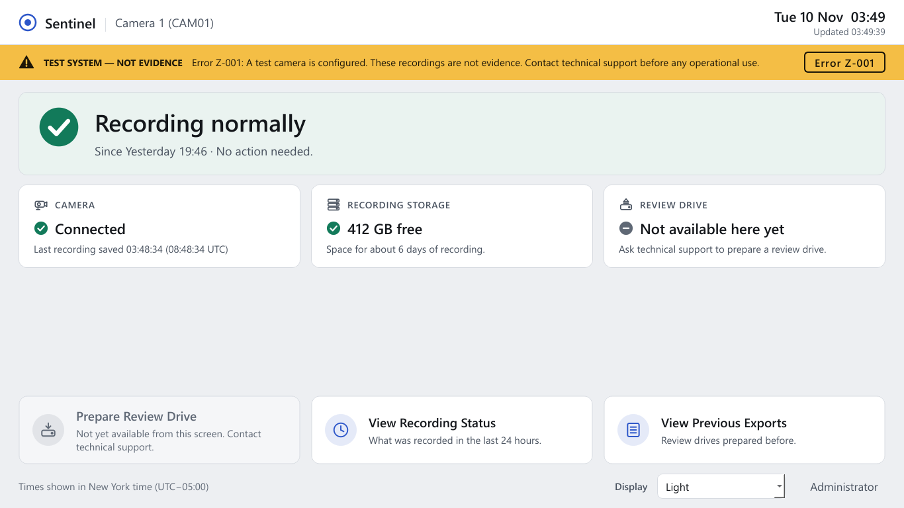 |
| R-003 notice (reconnecting automatically) | 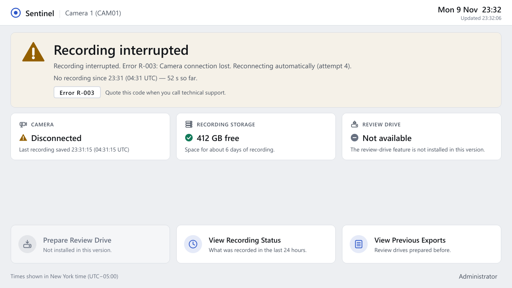 |
| R-003 critical "Recording stopped…" | 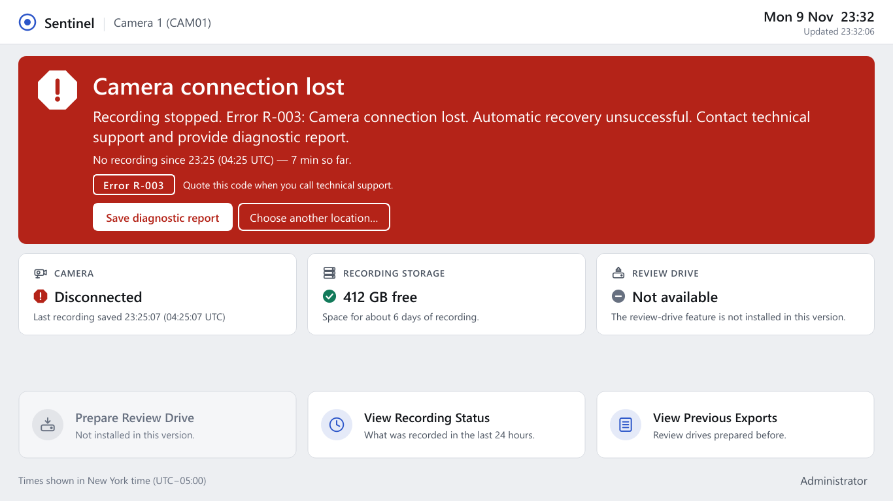 |
| S-002 storage full | 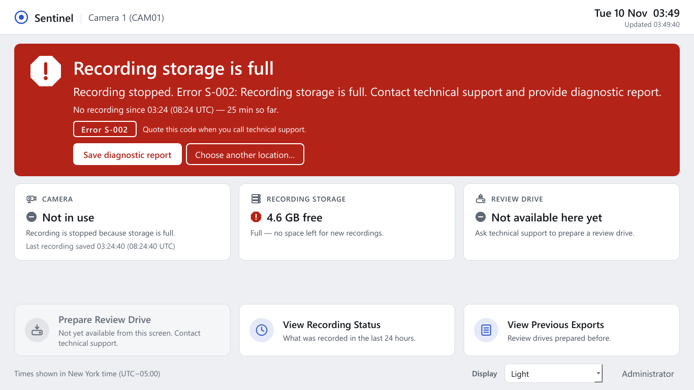 |
| X-001 recorder not responding | 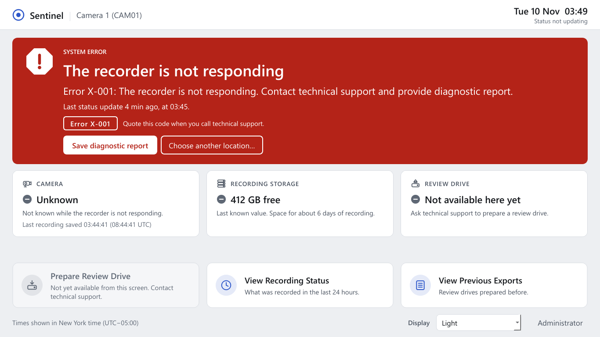 |
| R-003 critical on a test camera (Z-001 strip stays visible) | 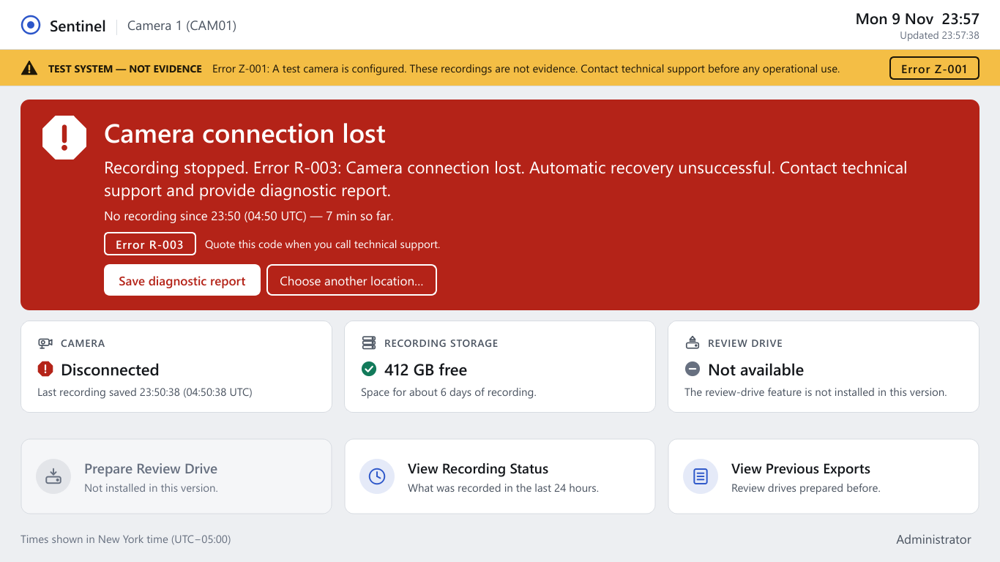 |
| View Recording Status (24 h timeline) | 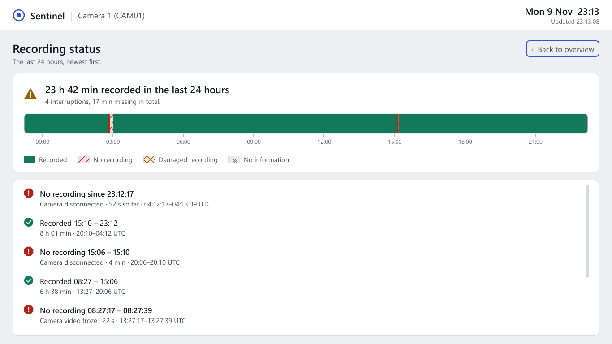 |
| View Previous Exports (none yet) | 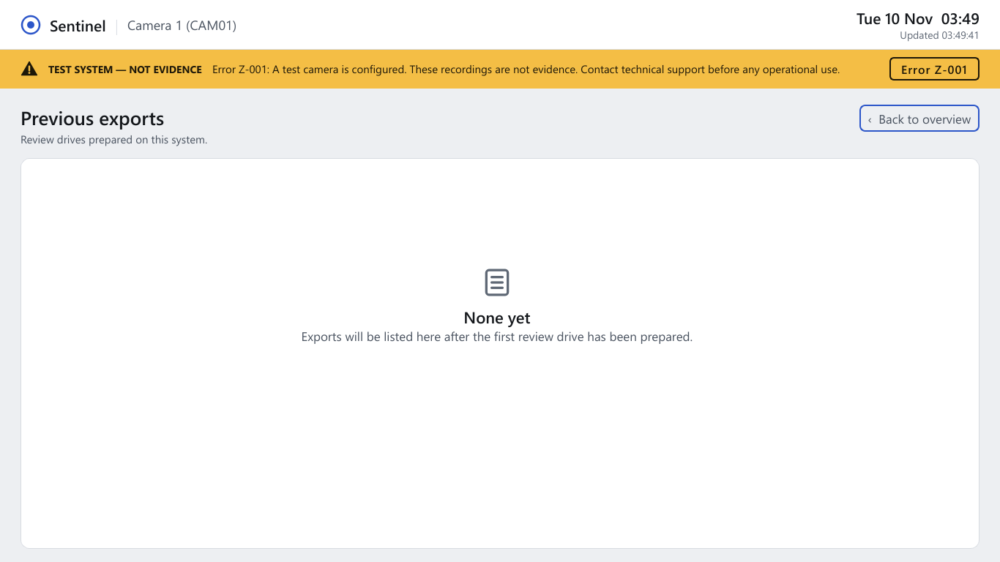 |
| View Previous Exports with records (export branch schema, plain-word outcomes) | 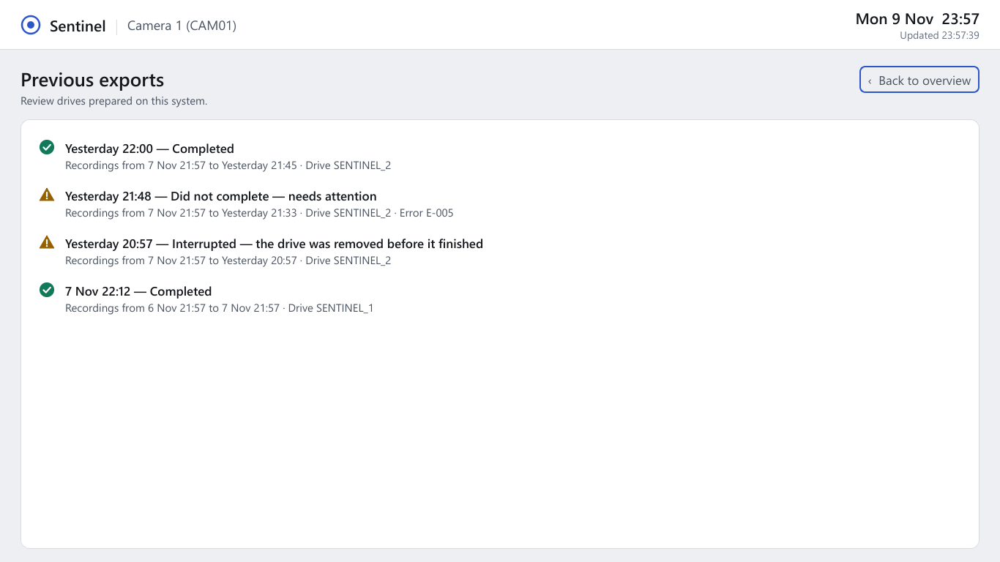 |
| Dark: recording normally (test camera) | 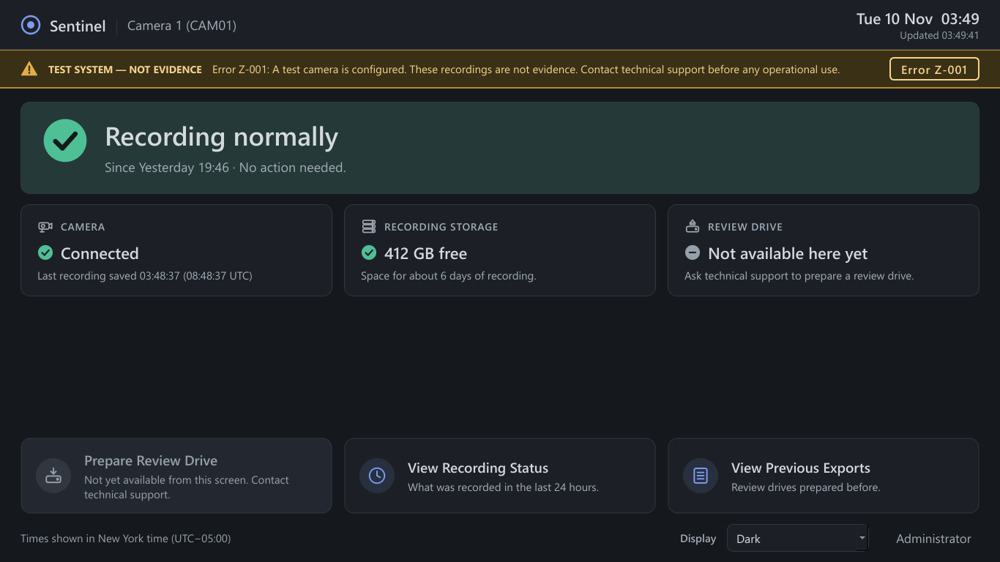 |
| Dark: R-003 critical | 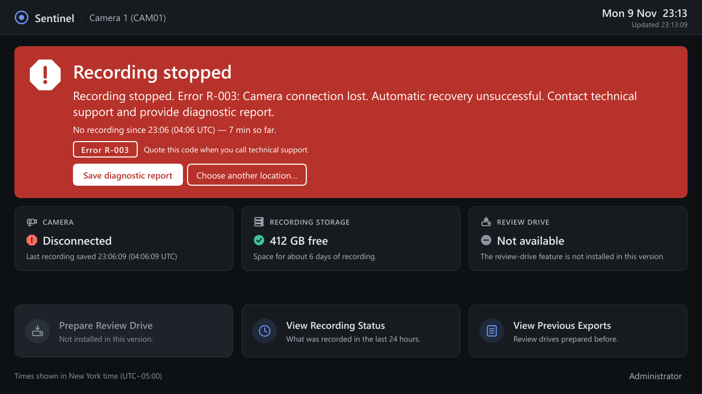 |
| Dark: S-002 storage full | 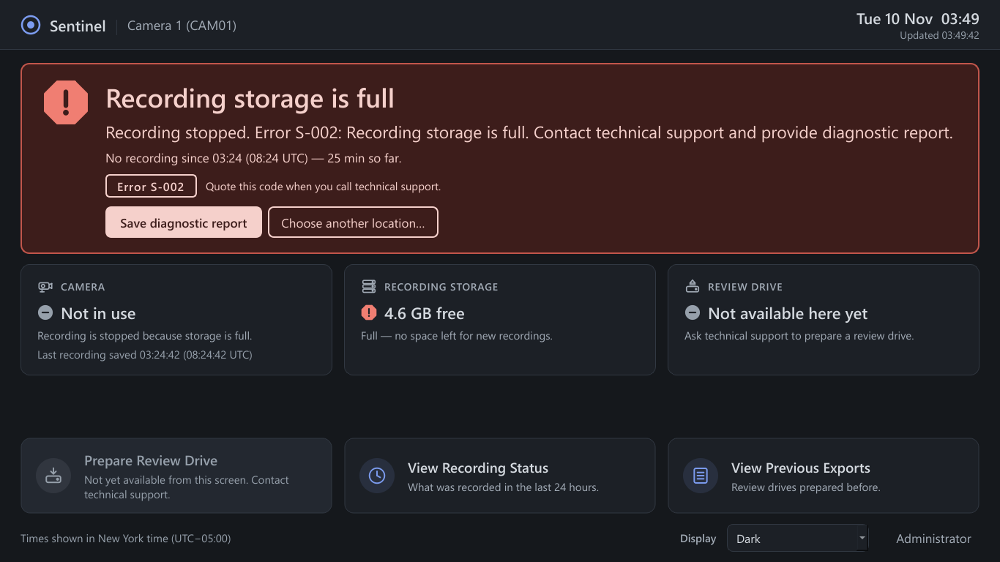 |

## 5. Tests (development host, Windows 11, Python 3.14.3, FFmpeg 9.0.1)

| Command | Result |
|---|---|
| `python -m pytest tests/unit -q -p no:cacheprovider` | **202 passed** (50 existing + 152 GUI tests), 0 failed — after the review fixes and the display setting |
| `python -m pytest tests/integration/test_gui_recorder.py -q -p no:cacheprovider` | **2 passed** (after the QA fixes; also earlier runs, each passed after fixing the test's own status read, see below) |
| `python -m pytest tests/integration/test_service_process.py -q -p no:cacheprovider` | **1 passed, 1 failed** (`test_hard_kill_restart_recovery_and_graceful_stop`, `sqlite3.OperationalError: disk I/O error`) — **also fails on unmodified `main`** in the same session (main: 1 pass then 2 fails; this branch alone: 1 pass, 3 fails). Not caused by this branch (no recorder code changed); see §7. |

What the new tests cover:
* every `OverallStatus` (states produced by the recorder's own `evaluate()`), unknown status;
* every catalogue code × every severity: shown text equals `alert.message` exactly, words present,
  tone matches severity, banner vs notice vs takeover;
* stale heartbeat, missing file, unreadable file ⇒ X-001 with the exact X-001 message; raw problem
  text (may contain paths) not shown; one transient unreadable read tolerated once, twice ⇒ X-001;
  status.json replaced every ~5 ms while read continuously for 3 s ⇒ never X-001;
* heartbeat in the future beyond the limit (wall clock set back) ⇒ X-001; small jitter is fine;
  heartbeat that stops changing for longer than the limit on the GUI's own monotonic clock ⇒ X-001
  (viewmodel and the real window, with a fake monotonic clock); malformed heartbeat ⇒ X-001, no crash;
* Prepare Review Drive is disabled and launches nothing even with `export_available=True`;
* previous exports in the export branch's real `export_batches`/`drives` schema: every state
  (incl. an unknown one) shown as a fixed plain-word outcome, never the raw state; drive label
  via `drives`; only a well-formed `E-0xx` code is shown;
* operator screens (overview, timeline, exports, PIN screen, tooltips, accessible names) contain no
  `rtsp|ffmpeg|codec|h264|.ts|.db|.json|tcp://|C:\|/var/…` even when the status carries a storage
  error with a Windows path, an RTSP URL and an SQLite error;
* ledger opened read-only (an INSERT raises "readonly database"); ledger, WAL and status.json bytes
  unchanged after refreshes and page visits; no other file created in the data folder;
* critical takeover: title is the catalogue headline and the message does not start with it (no
  visible repetition), message still exact;
* Z-001 strip on screen while R-003 critical takes over, on the overview, timeline, exports and PIN
  pages; Z-001 shown from configuration when no status exists; no strip for a production camera;
* display setting: default/unreadable/unknown ⇒ Follow Windows; save/restore round trip; unwritable
  location fails safe; default location is the user profile; Follow Windows maps to the OS setting
  and follows a live change; choosing Dark in the control re-themes, is saved and is restored by a
  new window; admin re-locks on re-theme; contrast ≥ 4.5:1 for all key pairs in both themes; dark
  fills stay below 5 % luminance; dark critical takeover and Z-001 strip render with icon + words;
* exactly three routine buttons, no Stop; keyboard (Enter opens, Esc returns); all buttons and the
  status area and Display control fully visible at 1366×768, with no scrollbar, in light and dark for all six
  scenarios and both disabled-button wordings; fonts ≥ 14 px,
  headline ≥ 30 px; admin area locked without PIN, wrong PIN refused, lockout, re-locks on leave;
* timeline: plain sentences ("No recording 14:05 – 14:09", "Camera disconnected · 4 min · …UTC"),
  within-segment freeze cut out, open gap "so far", unsaved current segment shown as "Recording now";
* diagnostic report saved to a user folder never prunes or overwrites the user's files;
* **recorder unaffected**: real `Harness` + FFmpeg + simulated camera; (a) the real MainWindow runs
  with its 2 s timer for 5 s, visits all pages and is closed; (b) `python -m sentinel.gui` runs as a
  separate process and is killed. In both, segments keep sealing, status stays RECORDING with a fresh
  heartbeat, the run is not restarted, and the service later exits 0.

One test fix during development: my integration test first used `Harness.status()`, which returns
`{}` on a transient Windows sharing violation while the recorder replaces status.json; it now
retries. (The same race is why the GUI's reader retries.)

## 6. Decisions and their reasons
* **Admin gate = PIN, not an OS-administrator check.** Appliance PCs are often run from an account
  that *is* a local administrator (an OS check would let every operator in), and this development
  account is not (it would lock admins out). A PIN is explainable on the phone and identical on
  Windows/Linux. Set with `python -m sentinel.gui --config <toml> --set-admin-pin`. It is **not a
  security boundary**: the admin area is read-only and shows data already readable by the GUI's
  account. Evidence access control remains OS accounts/permissions (E5, docs/07).
* **Diagnostic report goes via a temp folder.** `build_report` prunes older
  `Sentinel_Diagnostics_*.zip` in its output folder (keeps 20); called directly on the Desktop it
  would delete the user's files. The GUI builds in a temp folder and copies (with read-back check).
* **One read-only SQLite connection per refresh**, closed after use: no long read transaction can
  hold back the recorder's WAL checkpoints; a ledger created after the GUI started is picked up.
* **Previous exports**: reads the export branch's `export_batches` (state, finished/updated/planned
  time, interval, `error_code`) and `drives.label`; every state maps to a fixed plain-word outcome
  ("Completed", "Did not complete — needs attention", "Interrupted — the drive was removed before it
  finished", "Not finished", "Result not recognised by this screen"). If an export table exists that
  it cannot interpret it says "cannot be shown" rather than guessing.
* **Heartbeat checks** (in the GUI, `read_status` on main is unchanged): `|age| > limit` is stale, and
  a heartbeat value that has not changed for longer than the limit on the GUI's monotonic clock is
  stale regardless of any wall-clock change. Side effect: right after the wall clock is set back by
  more than 15 s, a *live* recorder can show X-001 for one 2 s refresh until it writes its next
  heartbeat (the recorder itself raises T-001 for such a clock change).

### Prepare Review Drive: intended interface (for integration; not implemented here)
The button is disabled ("Not yet available from this screen. Contact technical support.") until the
GUI↔export interface is defined. The removed launch path could not work: the export CLI needs
`--target <drive folder>` (drive selection belongs to the drives branch), prints its result only to a
console, and a frozen build has no `python -m`. Proposed interface:
1. **Request record, not a command.** The GUI writes one JSON request atomically to
   `<data_dir>/requests/export-<uuid>.json` (`{"kind": "review_export", "requested_utc": …,
   "operator": …}`), never the ledger and never a drive path. The GUI stays unprivileged and
   read-only towards evidence.
2. A long-running export/drive service (drives branch) picks the request up, selects the drive by
   identity (docs/04 §4–5), runs the export and writes progress to `<data_dir>/export_status.json`
   (the export branch already writes this file).
3. The GUI renders `export_status.json` (Checking drive → Copying → Verifying → **Safe to remove**,
   or the E-0xx message) using the same banner components; history comes from `export_batches`.
4. If a command is preferred instead, it must be started through a `sentinel.platform` launcher that
   resolves the frozen executable (e.g. `Sentinel.exe export …`) and captures its output; the GUI
   must never assume `sys.executable -m`.

## 7. NOT executed / not verified
* Python 3.12, Linux, real displays (all rendering was offscreen on Windows; high-DPI scaling and
  OS dark-mode detection on a real desktop not seen), screen readers.
* The export-history reader was tested against the export branch's schema copied into tests, not
  against that branch's code (it is not merged here).
* `--set-admin-pin` interactive prompt (getpass) not exercised by a test; `set_pin` itself is.
* "Choose another location…" folder dialog not exercised (offscreen); the save path behind it is.
* Other integration files (`test_media_hashing`, `test_recorder_faults`, `test_unattended`) not
  re-run: this branch changes no recorder code.

## 8. Risks, limitations, open decisions
1. **Read-only ledger after a recorder crash** — the failing `test_service_process` test (fails on
   `main` too) shows a read-only SQLite connection opened right after a hard kill can raise
   "disk I/O error" until the recorder restarts and recovers the WAL. The GUI catches this (history
   shows "not available"; status turns into X-001 once the heartbeat is stale), but the existing
   test is flaky on this host and should be fixed on `main` (retry or open after recovery).
2. A read-only SQLite reader creates `sentinel.db-wal`/`-shm` if they are absent (normal SQLite
   behaviour; tested that nothing else is written and the database bytes do not change). On Linux
   the GUI account needs read access to the data folder and write access for those two files, or
   the recorder must keep them present — to decide with the Linux permission model (docs/07).
3. Prepare Review Drive is disabled until the GUI↔export interface above is agreed and built
   (integration step with the export and drives branches).
4. "Recording since" = end of the latest gap in the ledger (or first footage); the "today" wording
   uses the display timezone.
5. The admin PIN file sits in the data folder; anyone who can write there can replace it (see §6:
   not a security boundary).

## 9. Recommendation
**Merge.** Prepare Review Drive is deliberately disabled with honest text until the
interface above is agreed and built. Nothing in this branch touches recording, all unit tests
and the GUI/recorder integration tests pass, and the one failing integration test also fails on
unmodified `main`.

## 10. Review findings
| Finding | Status |
|---|---|
| Orchestrator: critical banner repeated "Recording stopped" | Fixed: title = catalogue headline, exact message below |
| Orchestrator: Z-001 must be visible in every state | Fixed: persistent strip under the header, also from configuration |
| QA 3.1/3.2 (high): Prepare Review Drive launched an export command that could not work (no `--target`, output discarded, false "window opening" text, no `-m` in a frozen build) | Fixed: launch path removed; button disabled with honest text even if export is installed; interface documented above |
| QA 3.3 (medium): a wall clock set backwards hides a dead recorder (negative heartbeat age) | Fixed in the GUI viewmodel: a heartbeat age beyond the limit in either direction is stale, plus monotonic "heartbeat stopped changing" check; `read_status` on main unchanged |
| QA 3.4 (low): Previous Exports showed raw ledger outcome strings | Fixed: fixed plain-word outcomes for every state (unknown included), drive label from `drives`, only well-formed error codes |
| Owner: dark mode for discreet review in a dim room | Added: Display control (Light / Dark / Follow Windows), per-user memory, low-glare dark palette, AA contrast tested |
| Remaining | One live-recorder X-001 flash of at most one refresh right after a >15 s backward clock change (documented in §6); the interface for Prepare Review Drive is still to be built |

## 11. Field report 2026-11-19: a recorder that was stopped is not X-001 (0.3.25)

**Report (owner, at the end user's laptop).** "When I manually click stop recording it seems to fully
disconnect from the camera I think. It shows the Status as "Recording Stopped" for a few seconds, then
switches to "System Error"."

**Cause.** Section 2 says a stale heartbeat is X-001, and the window applied that to every recorder that no
longer writes its status. A recorder that is stopped with System › Stop recorder (or `Sentinel.exe stop`, or a
clean stop of the service) writes `overall = STOPPED` as its last document and then, rightly, writes nothing
more. For the first 15 seconds the window showed that document ("Not recording"); after that its heartbeat
was too old and the window showed X-001: "System error", "the recorder is not responding", camera "unknown".
Before that the Status page showed the camera as "disconnected", which is what the report read as losing the
camera. Reproduced on the development PC with a real recorder: "Not recording" at 1, 5, 10 and 14 s after the
stop, "System error" at 17 s. `tests/unit/test_gui_viewmodel.py` asserted this X-001 until 0.3.25
(`test_stopped_service_then_stale_reads_shut_down`); that test now asserts the opposite.

**Rule since 0.3.25.** `overall = STOPPED` is written only when the recorder ends without an error
(`RecorderService.run`: "a crash is reported as an error, never as a clean stop"), and it stays in place until
a recorder starts and replaces it. So it is a known state however old it is: `read_status_robust` returns it
as `ReadKind.STOPPED` (also when its heartbeat lies in the future after the clock was set back), and
`recorder_stopped(read)` is the one test every part of the window uses. A recorder that crashed, hung or was
killed never writes STOPPED and is X-001 exactly as before. `sentinel.status.read_status`, which the
self-check uses, is unchanged: a stopped recorder still does not pass as "answering".

**What the window shows while the recorder is stopped** (the same from the first second on):

| Where | Shows |
|---|---|
| Large words, left panel, status bar | "Not recording" (red, as before: an evidence recorder that is off is never green) |
| Under the large words | "The recorder was stopped at 16:08. Nothing is recorded until it is started again.", then the usual "No recording since ... so far." |
| Under that | **Start recording** (new). Not shown while a new version is being put in place, where recording restarts by itself |
| Alerts | "No alerts are reported while the recorder is stopped." The alerts in the last document were measured before the stop and are not shown as current |
| Camera (header and Details) | "not in use (recorder stopped)" instead of "disconnected" |
| Archive, clock, motion, sound | "not reported (recorder stopped)" and similar: the recorder is what measures them |
| Recorder (Details) | "stopped (16:08)" instead of "running, version ..." (first 15 s) or "not responding" (afterwards) |
| Status bar | "Recorder stopped" and "Recorder stopped 16:08:07" instead of "Recorder status not updating (X-001)" |
| Live view | "No live view: the recorder is stopped, so nothing is read from the camera." The recorder is the only part that connects to the camera, so stopping it does end the camera connection; that is by design and unchanged |

**Start recording** calls `base.start_recorder`: it never stops a recorder (if one runs it says so), starts it
through the same control the launcher uses (the Windows service when that is installed, else the background
process) and starts the archive copy if that is not running. It is offered in a read-only window too, since
opening Sentinel starts the recorder for the same person anyway; where Windows refuses (a standard user and
the Windows service), the message says to unlock first. It shares the restart's one-at-a-time slot, so the
window does not close while it runs and a restart asked for meanwhile runs afterwards.

Status commands (`Sentinel.exe status`, the console view, System › Check service) print "NOT RECORDING: THE
RECORDER IS STOPPED" with the UTC time, instead of "RECORDER NOT RESPONDING" (old document) or "STOPPED / No
problems detected" (fresh one, docs/branches/design-single-executable.md, limitation 6).

**Tried (2026-11-19, development PC).** Real background recorder on the simulated camera, real window,
`Sentinel stop`, 18 s wait, Start recording, "Recording normally" again: `tests/integration/test_gui_stop_start.py`.
The window was also drawn with Windows' own drawing and looked at (wide and 990 px wide). Full suite on that
PC: 1702 passed, 2 skipped, 1 failed, the timing test that fails there on unchanged versions too
(docs/branches/motion-recording.md). The built 0.3.25 program (commit 72a5217, window and recorder both from
the build, simulated camera, its window read and its button pressed through Windows UI Automation): "Not
recording", "The recorder was stopped at ...", camera "not in use (recorder stopped)" and the Start recording
button at 4 s and at 20 s after `Sentinel.exe stop`; button pressed; "Recording normally" 30 s after the
stop and the button gone. **Not tried:** on
the laptop; with the real camera; with the Windows service installed (the control is the tested
`ServiceControl`, but a real StartService from the window was not run); pressing the button by hand.

**Not changed, and worth a decision.** The recording log holds the stop (`graceful_stop`, `service_stop`) but
not who asked for it or from where; a stop from the window is not told apart from Windows shutting down.

## 12. Field report 2026-11-20: Safely remove… was offered for the archive drive in use (0.3.27)

**Report (owner, training the agents at the laptop, window in administrator mode, no camera connected).**
"When I tried to Safely Remove Drive, I got an error, error M-007." The screen: SSD_1 "In use", selected in
Drives plugged in, with **Rename…** and **Safely remove…** under the list; the output pane read "Error M-007:
The drive could not be safely removed. Do not unplug the drive yet. Close any open files on it and try again.
If this continues, contact technical support." and under it "SSD_1 is an archive drive and archive copying is
running. Press Swap and safely remove instead: ...".

**Cause.** Not the missing camera. The page has two buttons with nearly the same name. **Swap and safely remove**
(archive box) is the one that takes an archive drive out. **Safely remove…** (drive list) runs `drives eject`,
which has refused an archive drive while copying runs since the review of 2026-11-12 (the copier may be writing
to it). So for the drive in use the second button could never work, and the page offered it all the same. Its
answer then looked like a fault: an error code, advice about open files that had nothing to do with it, and
"contact technical support", with the one useful sentence last.

**Since 0.3.27.**

| Selected drive | Safely remove… in the list | The line under the list ends with |
|---|---|---|
| archive drive the copier reports as in use | not offered | "Archive copying is using it now. To take it out, press Swap and safely remove." |
| standing by, or full and not yet swapped | not offered | as before (full: "press Swap and safely remove before taking it out") |
| prepared by a swap | offered (and the page's own "Safely remove SSD_1" above) | |
| taken out with a swap and plugged in again | offered, and now works (docs/04, section 3) | "Sentinel is not copying to it. Safely remove… takes it out again." (administrator window) |
| any other drive; any drive while copying is not running | offered, as before | |

It is the rule Return to service… has followed since 2026-11-17 (`ACTIVE_USES`). The command still refuses a
drive in use (command line; a list that is a few seconds old), now with the reason first: M-007's general
sentence no longer mentions open files (docs/04, section 3), and what the person was told is written to the
recording log (`drive_not_removed`).

**The state the laptop was in.** The screen also showed "Some recordings could not be copied to the archive
drive. Not yet archived: 15 h." (A-008, with V-001 and A-006). A swap does not wait for what cannot be copied:
`_step` runs `_do_swap` before it looks for the next recording. `tests/unit/test_safely_remove_archive_drive.py`
puts the real copier into that state (a recording that no longer matches its sealed hash), presses Swap and
then runs the page's removal.

**What the laptop's diagnostic report showed (same day).** V-001, A-006 and A-008 were not from the missing
camera either. 324 of the 327 recordings in the log were gone from the storage folder: the owner had deleted the
test recordings by hand ("there's no other way to do so"), and the swap of 09:23 that morning had come from a
read-only window. Sections 13 and 14 are the two things asked for after that.

**Not changed.** In a read-only window (no administrator rights) both Safely remove buttons are greyed out, as
before: after a swap such a person is sent to the button and cannot press it, and is left with Windows' own
Safely Remove Hardware, which the copier's message also names. Whether the agents' window is in administrator
mode on the laptop is not known here.

## 13. A new recording log: clearing test recordings before real use (0.3.27)

**Need (owner, 2026-11-20, hours before the recorder went into real use).** "I have to clear the folder to
remove test recordings before the real recordings start and there's no other way to do so. All motion recording
schedules, Camera IP addresses, etc. must be left in place but the history needs to be cleared." Deleting the
files by hand leaves a log that lists every one of them; the recorder then reports each as missing for good.

**`Sentinel.exe new-recording-log`** (`sentinel.newlog`; administrator; `START-A-NEW-RECORDING-LOG.cmd` in the
hand-carry folder runs it). In order: stop the recorder and the copier and hold both instance locks; write
`recording_log_closed` into the log in use; copy that log to `<data>/previous-recording-logs/<UTC>/`, compare
the copy by SHA-256, and only then empty the log file in place; move the copier's state and the diagnostic
reports there too; delete the storage folder's contents; empty Sentinel's own folders on every archive drive
that is plugged in (the marker, and so the drive's name, stays); start the new log with `recording_log_started`
(who, why, what was removed, the earlier log's folder and chain head) and one `drive_name_carried_over` per
drive name used so far, which `next_label` reads; remove the stale `status.json` and ledger snapshot. Settings,
the camera's sign-in and the installed versions are not touched.

Decisions and why:

* **The earlier log is never deleted.** A step that clears an evidence recorder's history has to leave a trace
  that it happened and of what existed before. The folder holds the whole log; the new log's first entry names
  it and its fingerprint.
* **Emptied in place, not replaced.** An empty file is a new database to SQLite and keeps the file's owner and
  permissions. A log created afresh by the administrator command could be unwritable for a recorder that runs
  without administrator rights (the laptop starts the recorder from the window).
* **Nothing is removed unless the log could be set aside.** A Sentinel window that is still open has the log
  open: the command then writes `recording_log_close_abandoned`, starts recording again and stops. Checked by
  an open that shares nothing (Windows) and by leftover `-wal`/`-shm` files.
* **Typed confirmation** (`NEW LOG`) after a listing of what will be set aside and removed; `--dry-run` shows
  the listing only. No button in the window: it is done once, by the administrator.
* **Recording is never left stopped.** The command starts the recorder and the copier again itself, as an
  update does, also when it refuses because the log is open elsewhere. Once the log is set aside, a failure in
  one of the later parts (a drive that cannot be emptied) is written into the new log's first entry instead of
  stopping the rest.

A drive that is not plugged in keeps its test recordings; the listing says so before the confirmation.
Tests: `tests/unit/test_new_recording_log.py` (the real log, copier and a folder as drive).

### 13.1 A run that cannot end unseen (0.3.29)

**Field report (owner, 2026-11-20, on the laptop, minutes before real use).** "We have minutes remaining and the
new log command did absolutely nothing and there was no indication whether it actually was doing anything or
not. All the errors and alerts are still there, everything." Then: "The command did nothing the first time. It
popped up with instructions, then said press any key to continue. The window closed and nothing else. The second
time when the window closed a new one popped up asking me to type NEW LOG. That worked."

**What is known and what is not.** The second run did the step. The first run changed nothing and left no trace
anywhere, so its cause **is not known**; nor is why the question appeared to be in a new window the second time
(in the trials here it is asked in the script's own window). One way to get exactly the first run's result was
reproduced on the 0.3.27 code in a real console: between the key at "Press any key" and the first line of the
listing nothing is shown (the program starts and counts what is on the computer and on the archive drives). A
key pressed again in that stretch stays in the keyboard buffer, answers "type NEW LOG" with an empty line,
which cancelled ("Not confirmed. Nothing was changed."), and one more key ended the script's last
`pause`, and with it the window. Whether that is what happened on the laptop cannot be told.

So the script and the command are held to this instead: **whatever happened is still on the screen when the
person looks, a key pressed too early or too often changes nothing, and every run leaves a line.**

* `newlog.main` says "Looking at the recording log ... This can take a minute. Do not press anything until a
  question is on the screen." before it looks, not after.
* Keys pressed before the question are dropped (`discard_typed_ahead`: `FlushConsoleInputBuffer`, each time the
  question is asked). An empty line is not an answer: "Nothing was typed." and the question again, three times
  (`ask_to_confirm`). Anything else that is not the words still cancels.
* Every run writes what became of it to `<log folder>/new-recording-log.log` (`note_attempt`): started (with
  administrator rights or not, with a keyboard or not), not confirmed and why, confirmed by whom, done, refused.
  The diagnostic report carries the file. The folder is never created by this command (as administrator it
  would get the wrong owner).
* `START-A-NEW-RECORDING-LOG.cmd`: one `pause` only, before anything is looked at, with "press a key ONCE ...
  press nothing more"; NOT DONE and NOT STARTED (no administrator rights) in a box; and every way out ends in a
  question that only the word CLOSE answers, so no key closes the window by accident. With no keyboard (input
  from a file: `timeout.exe` refuses it, which is the test) the script does not wait.

Tests: `tests/unit/test_new_recording_log.py` (asked again, the lines written, keys dropped before each ask) and
`tests/unit/test_new_recording_log_script.py` (the script run as it is against a stand-in program).

**Tried (2026-11-20, development PC),** each in a real console of its own, hidden, keys put into its input
buffer as a keyboard does: the question from the source, Enter twice during a four-second look: 0.3.27 code
cancels at once; 0.3.29 code shows the question once and waits, asks again after Enter alone, goes on after
NEW LOG and a name. The script with the built 0.3.29 and with the built 0.3.28, without administrator rights:
NOT STARTED in its box, the window still there after Enter three times and "x", gone after "close"; with the
administrator check taken out: waits at "Press any key" (6 s, no key), then one key and two more Enters at
once: the listing, the program's refusal (no administrator rights), NOT DONE in its box, the window still there
after more Enters and "q", gone after CLOSE; the lines in `new-recording-log.log`.
**Not tried:** with administrator rights in a window on the desktop (the trials here had none, so the program
stopped before its question; the question was tried from the source); in Windows Terminal with nobody at the
PC (console windows opened on the desktop there took the key presses of the person using it, which is how the
first trials misled: their "Press any key" seemed to go on by itself); the laptop.

## 14. Notes (0.3.27)

**Request (owner, 2026-11-20).** "Add a Notes tab. I'll explain to the agents that if they mess up or do
something wrong, to just notate the 5 Ws in that tab and save it so there's a stored reason for things."

A seventh section, **Notes**, after Drives (`gui/app/notes_page.py`): five fields (Who, What, When, Where, Why;
Who and What are required), **Save note**, and the saved notes below, newest first. A note is an entry of the
recording log (`operator_note`, category `notes`, severity audit): it carries the time it was saved and the
Windows account, cannot be edited or deleted, is covered by the log's chain like every other entry and is in the
diagnostic report (`events.csv`). It needs no administrator rights where the window's account can write the log
(recorder started from the window, as on the laptop). Where it cannot (recorder installed as a Windows service),
the page says the note was NOT stored and keeps the text in the form; a request-folder route for that set-up is
not built.

A new recording log sets the notes aside with the rest of the earlier log.

**Tried (2026-11-20, development PC), sections 12 to 14.** Full suite on the final code: 1734 passed, 2 skipped
(30 min 48 s; the timing test that often fails on that PC passed). Before sections 13 and 14 were added:
1724 passed, 2 skipped. The built 0.3.27 (commit c10c2a0), its own recorder recording from the simulated camera
(10 s files), its own copier with no drive, administrator rights: `new-recording-log --yes --confirm "NEW LOG"`
took 2.9 s; the earlier log was set aside whole (5 recordings, chain intact, last entry `recording_log_closed`),
its 10 files were deleted, the new log began with `recording_log_started` naming the earlier log's folder and
chain head, the recorder started again by itself and recorded 5 files, and the only alert was Z-001.
`START-A-NEW-RECORDING-LOG.cmd` was run three ways: without administrator rights (says so), as administrator
with nobody typing ("Not confirmed. Nothing was changed.", nothing changed), and against a 0.3.26 program
(told to install first). Notes in the built window, read-only mode, through Windows UI Automation: five fields
set, Save note pressed, "Saved. The note is in the list below.", the note listed and in the log.
**Not tried:** emptying a real archive drive (the unit tests use a folder; a marked volume on that PC would
have been taken by the Sentinel installed there); the laptop; NEW LOG typed at a keyboard; the Windows
service; Safely remove against a real drive and Windows' own removal.
