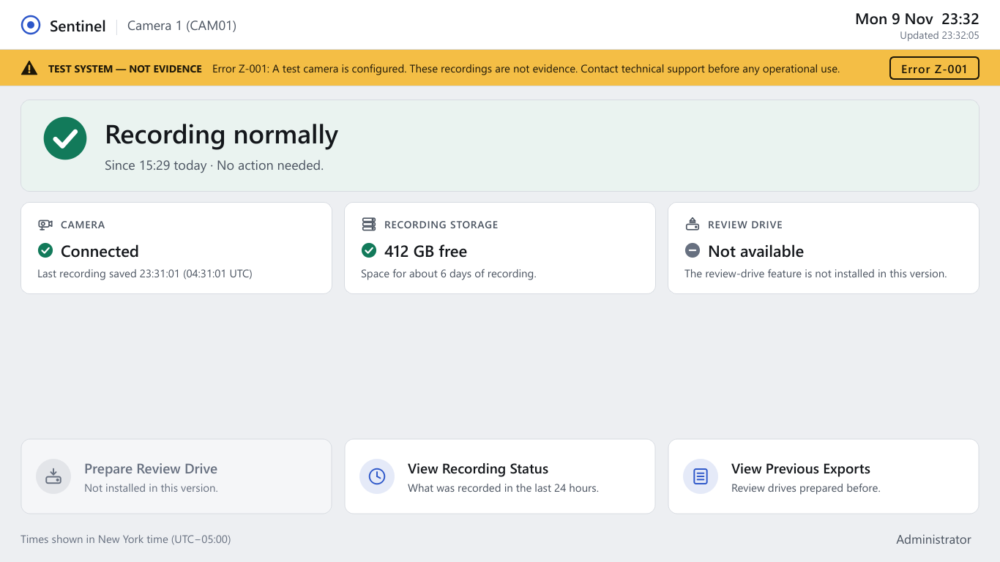
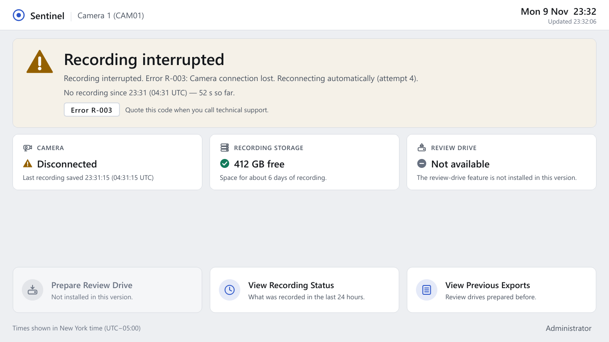
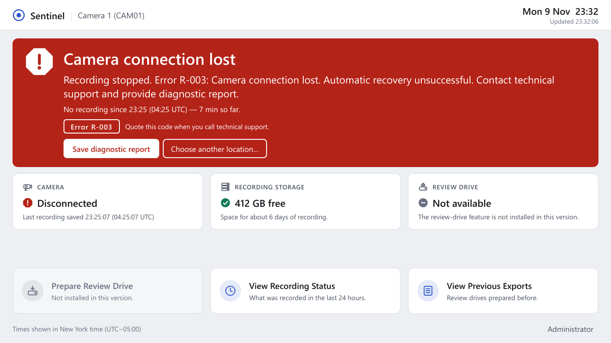
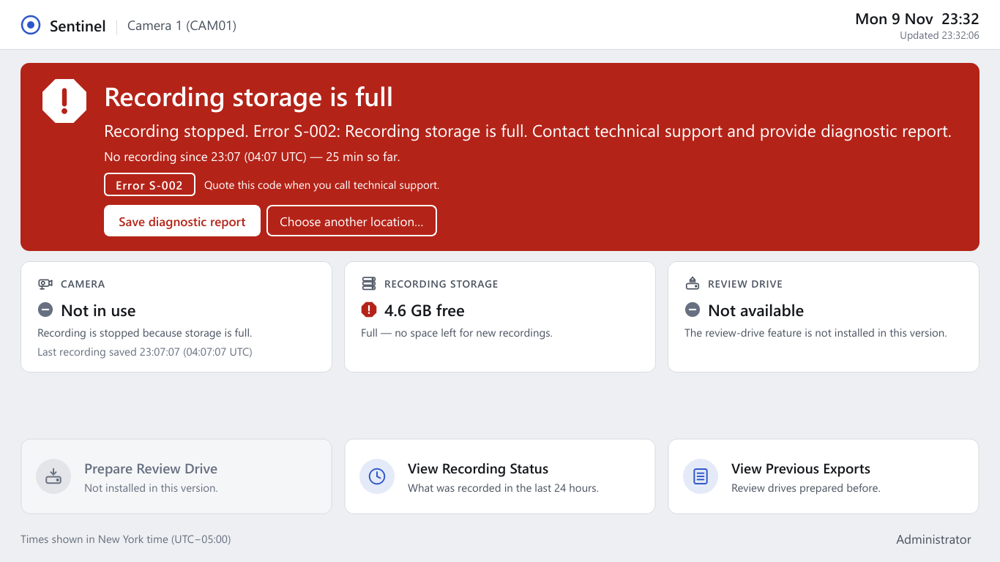
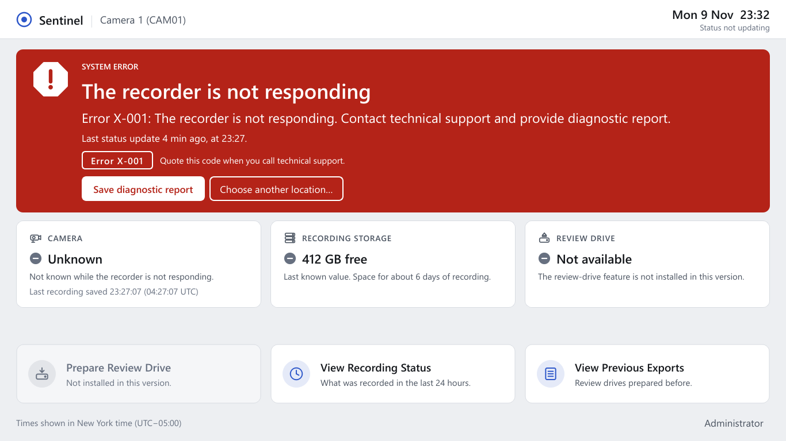
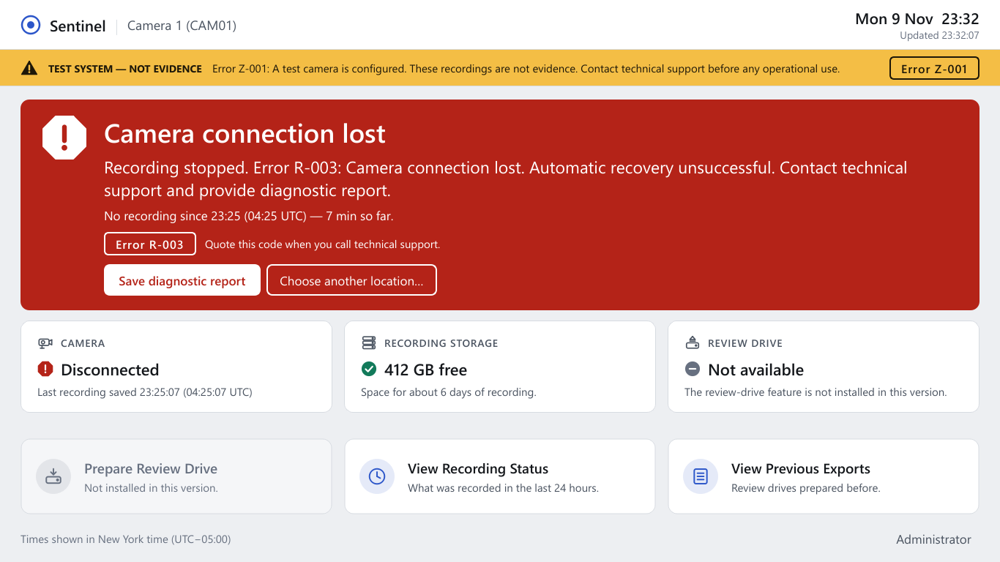
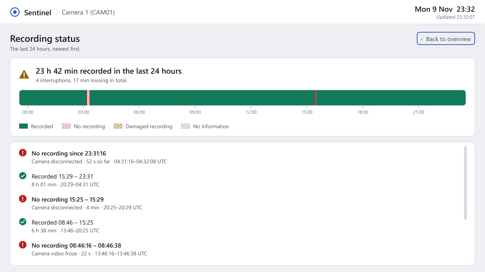
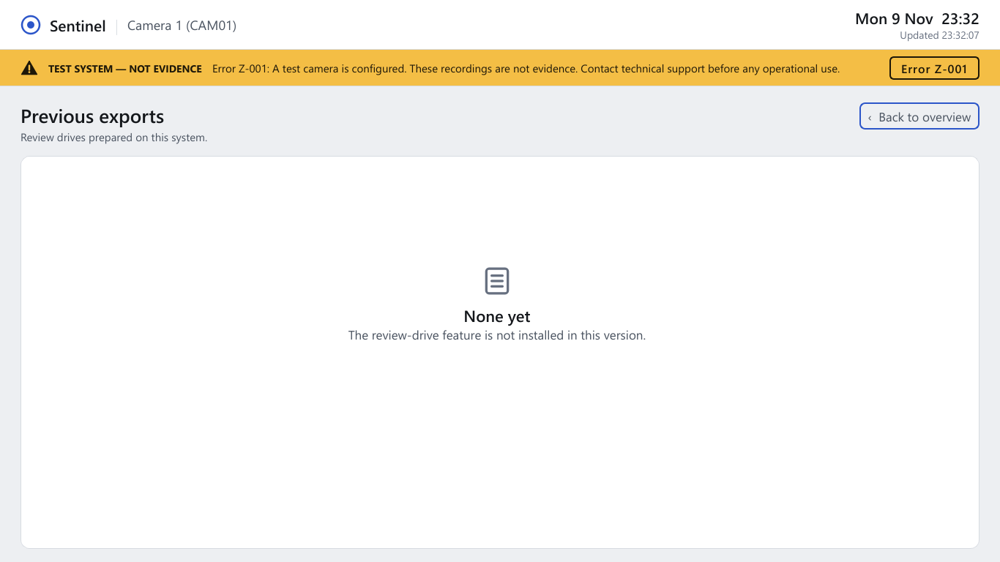
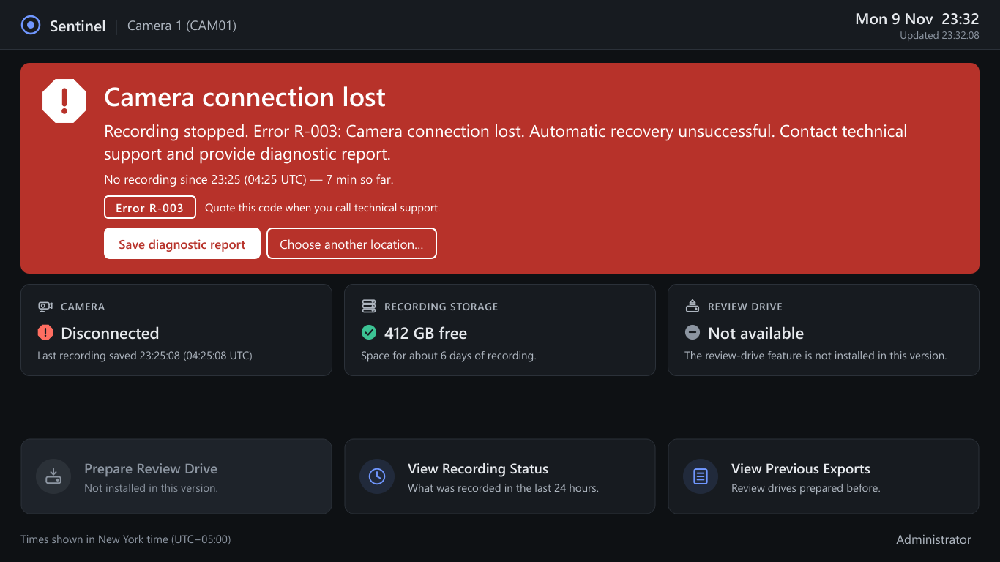

# Branch `req/operator-gui` — Operator screen (PySide6)

## 1. Summary
This branch adds the operator screen: one window that shows, in plain words, whether the camera is
being recorded, how much storage is left, and — when something is wrong — a large banner with the
exact error message and code to read to technical support, plus a one-click "Save diagnostic
report". It only *reads* what the recorder writes; it cannot start, stop or disturb recording,
and a test proves that closing (or killing) it leaves a real recording running. Drive export is
not part of this branch and the screen says so honestly instead of pretending.

## 2. Requirements addressed

| Item | ID / source | Stated or design choice |
|---|---|---|
| Operator GUI in PySide6, `python -m sentinel.gui --config <toml>` | Brief §4 | Stated |
| Design for the least proficient user; plain words; no paths/codecs/commands on operator screens | U1, U7 | Stated |
| Exactly three routine buttons: Prepare Review Drive, View Recording Status, View Previous Exports; no Stop button | U4, brief §4 | Stated |
| Administrator area separate from operators | U5 | Stated; **PIN gate is my design choice** (§6) |
| GUI reads only measured state (status.json + read-only ledger); closing it has zero effect on recording | U6, architecture §2.4 | Stated |
| Banner shows exact `alert.message`, icon **and** words, code readable aloud, "Save diagnostic report" | U7 | Stated |
| Stale/missing heartbeat ⇒ X-001 shown prominently | Architecture §2.4, status.py | Stated |
| Z-001 (test camera) always visible | Task brief | Stated |
| 24 h recording timeline (recorded vs gaps, reason in plain words) | E3 (continuity) | Stated (task); layout is my design |
| Display timezone with UTC alongside | E1 | Stated |
| 1366×768, large fonts, keyboard, 2 s refresh, robust to status.json replacement | Task brief | Stated |
| Light and dark themes (follows the OS) | Owner guidance | Design choice |
| Prepare Review Drive launches `python -m sentinel.export run --config <toml>` only if that module exists | U4 | Stated; the `--config` argument is **my assumption** about the export CLI |

## 3. What changed
* `src/sentinel/gui/` (new):
  * `viewmodel.py` — Qt-free: maps a status read to headline/tone/banner/tiles; `read_status_robust`
    (wraps `sentinel.status.read_status`, retries a transient unreadable file before reporting X-001).
  * `ledger_view.py` — Qt-free, read-only ledger queries (`Ledger(path, readonly=True)`, one
    connection per refresh, autocommit so no read transaction is held): dashboard snapshot,
    24 h timeline builder, previous-exports reader, administrator data.
  * `admin_pin.py` — PBKDF2-SHA256 PIN (salted, 200 000 iterations) in `<data_dir>/gui_admin_pin.json`,
    5 wrong tries ⇒ 60 s lockout.
  * `report.py` — saves `build_report` output to the Desktop or a chosen folder via a private temp
    folder (see §6), read-back hash check, never overwrites.
  * `textfmt.py` — times ("Yesterday 22:10", "14:05 UTC"), durations, sizes, "about 6 days".
  * `theme.py`, `icons.py`, `widgets.py`, `pages.py`, `window.py`, `__main__.py` — the Qt layer.
* `pyproject.toml`: optional extra `gui = ["PySide6-Essentials==6.11.3", "shiboken6==6.11.3"]`,
  script `sentinel-gui`. `requirements/gui.txt` with the same pins.
* Tests: `tests/unit/test_gui_viewmodel.py`, `tests/unit/test_gui_widgets.py`,
  `tests/integration/test_gui_recorder.py`, shared `tests/gui_support.py`; screenshot renderer
  `tests/render_gui_screenshots.py`.
* No recorder code was changed. The recorder never imports Qt (checked: importing
  `sentinel.service` loads no PySide6 module).

### Dependency: PySide6-Essentials 6.11.3
Installed into the shared venv (`pip install PySide6-Essentials==6.11.3` → also `shiboken6==6.11.3`).
Why this exact version: on Python 3.14 pip offers only 6.10.1 and newer; 6.11.3 is a mature patch
release of the previous minor line (6.12.0 is the newest). Its wheel is tagged `cp310-abi3` with
`Requires-Python >=3.10,<3.15`, so the *same* pin installs on 3.12 and 3.14 (3.12 install not
executed here). *Essentials* instead of the `PySide6` meta-package: the GUI uses only
QtCore/QtGui/QtWidgets; the Addons wheel (WebEngine, Multimedia, 3D…) is ~200 MB of unused code.
LGPL-3.0, as planned in docs/01 §5.

## 4. Design (owner guidance: "obvious", calm, not childish, not a stock Qt form)
* One dominant element: the state in words ("Recording normally · Since 15:10 today · No action
  needed"). Critical alerts *take over* that area (red, white text) instead of popping dialogs;
  warnings (e.g. S-001) appear as a full-width amber banner above it; notices (automatic
  recovery in progress) explain the state inside it.
* Critical takeover, without repeating itself (review fix): the large title is the alert's catalogue
  headline ("Camera connection lost", "The recorder is not responding"); directly under it the
  **exact** `alert.message` ("Recording stopped. Error R-003: …"). A small state word ("SYSTEM
  ERROR") appears above the title only when the message does not already begin with it.
* **Z-001 test-camera marker is visible in every state and on every page** (review fix): a slim
  amber strip under the header, outside the page stack, with icon, "TEST SYSTEM — NOT EVIDENCE",
  the exact Z-001 message and the code. It is driven by the status alerts *and* by the
  configuration (`development_source = true`, the recorder's own Z-001 condition), so it stays up
  even when no status can be read (X-001). It is not repeated in the dashboard banner.
* Status is never colour alone: each tone has its own icon **shape** (circle-check, circle-i,
  triangle, octagon, circle-dash) and words ("TEST SYSTEM — NOT EVIDENCE", "Recording stopped").
  Colours come from the colour-blind-safe Okabe-Ito family; the timeline uses solid / hatched /
  cross-hatched / dotted patterns plus a worded legend.
* The error code sits in a letter-spaced pill ("Error R-003") with "Quote this code when you call
  technical support."
* The three routine buttons are anchored at the bottom in the same place in every state.
* Headline mapping (`overall` → words): RECORDING "Recording normally"; STARTING "Starting
  recording"; INTERRUPTED "Recording interrupted"; STORAGE_WARNING "Storage warning";
  STORAGE_FULL "Recording stopped"; ERROR "System error"; STOPPED "Not recording"; unknown or
  stale ⇒ "System error". Any critical alert that stops recording turns the headline into
  "Recording stopped" (owner wording, U7). **Design choice:** the brief lists four states; the
  recorder has seven, and calling a storage-full stop a "warning" would understate it.
* Camera tile does not blame the camera when recording stopped for another reason (storage
  full, system error ⇒ "Not in use"), and shows "Unknown" while the recorder is not responding.

### Screenshots (offscreen, 1366×768, real ledger + status produced by the recorder's own `evaluate()`)
Re-generate with `python tests/render_gui_screenshots.py`. Scenarios named "test camera" use the
simulator configuration (so Z-001 shows); the others use a production-style camera configuration
(a documentation-range address that is never contacted), so no Z-001 strip appears.

| | |
|---|---|
| Recording normally, test camera (Z-001) |  |
| R-003 notice (reconnecting automatically) |  |
| R-003 critical "Recording stopped…" |  |
| S-002 storage full |  |
| X-001 recorder not responding |  |
| R-003 critical on a test camera (Z-001 strip stays visible) |  |
| View Recording Status (24 h timeline) |  |
| View Previous Exports (none yet) |  |
| R-003 critical, dark theme |  |

## 5. Tests (development host, Windows 11, Python 3.14.3, FFmpeg 9.0.1)

| Command | Result |
|---|---|
| `python -m pytest tests/unit -q -p no:cacheprovider` | **168 passed** (50 existing + 118 new GUI tests), 0 failed — after the review fixes |
| `python -m pytest tests/integration/test_gui_recorder.py -q -p no:cacheprovider` | **2 passed** (after the review fixes; also 3 earlier runs, each passed after fixing the test's own status read, see below) |
| `python -m pytest tests/integration/test_service_process.py -q -p no:cacheprovider` | **1 passed, 1 failed** (`test_hard_kill_restart_recovery_and_graceful_stop`, `sqlite3.OperationalError: disk I/O error`) — **also fails on unmodified `main`** in the same session (main: 1 pass then 2 fails; this branch alone: 1 pass, 3 fails). Not caused by this branch (no recorder code changed); see §7. |

What the new tests cover:
* every `OverallStatus` (states produced by the recorder's own `evaluate()`), unknown status;
* every catalogue code × every severity: shown text equals `alert.message` exactly, words present,
  tone matches severity, banner vs notice vs takeover;
* stale heartbeat, missing file, unreadable file ⇒ X-001 with the exact X-001 message; raw problem
  text (may contain paths) not shown; one transient unreadable read tolerated once, twice ⇒ X-001;
  status.json replaced every ~5 ms while read continuously for 3 s ⇒ never X-001;
* operator screens (overview, timeline, exports, PIN screen, tooltips, accessible names) contain no
  `rtsp|ffmpeg|codec|h264|.ts|.db|.json|tcp://|C:\|/var/…` even when the status carries a storage
  error with a Windows path, an RTSP URL and an SQLite error;
* ledger opened read-only (an INSERT raises "readonly database"); ledger, WAL and status.json bytes
  unchanged after refreshes and page visits; no other file created in the data folder;
* critical takeover: title is the catalogue headline and the message does not start with it (no
  visible repetition), message still exact;
* Z-001 strip on screen while R-003 critical takes over, on the overview, timeline, exports and PIN
  pages; Z-001 shown from configuration when no status exists; no strip for a production camera;
* exactly three routine buttons, no Stop; keyboard (Enter opens, Esc returns); all buttons and the
  status area fully visible at 1366×768, with no scrollbar, in light and dark for all six scenarios; fonts ≥ 14 px,
  headline ≥ 30 px; admin area locked without PIN, wrong PIN refused, lockout, re-locks on leave;
* timeline: plain sentences ("No recording 14:05 – 14:09", "Camera disconnected · 4 min · …UTC"),
  within-segment freeze cut out, open gap "so far", unsaved current segment shown as "Recording now";
* diagnostic report saved to a user folder never prunes or overwrites the user's files;
* **recorder unaffected**: real `Harness` + FFmpeg + simulated camera; (a) the real MainWindow runs
  with its 2 s timer for 5 s, visits all pages and is closed; (b) `python -m sentinel.gui` runs as a
  separate process and is killed. In both, segments keep sealing, status stays RECORDING with a fresh
  heartbeat, the run is not restarted, and the service later exits 0.

One test fix during development: my integration test first used `Harness.status()`, which returns
`{}` on a transient Windows sharing violation while the recorder replaces status.json; it now
retries. (The same race is why the GUI's reader retries.)

## 6. Decisions and their reasons
* **Admin gate = PIN, not an OS-administrator check.** Appliance PCs are often run from an account
  that *is* a local administrator (an OS check would let every operator in), and this development
  account is not (it would lock admins out). A PIN is explainable on the phone and identical on
  Windows/Linux. Set with `python -m sentinel.gui --config <toml> --set-admin-pin`. It is **not a
  security boundary**: the admin area is read-only and shows data already readable by the GUI's
  account. Evidence access control remains OS accounts/permissions (E5, docs/07).
* **Diagnostic report goes via a temp folder.** `build_report` prunes older
  `Sentinel_Diagnostics_*.zip` in its output folder (keeps 20); called directly on the Desktop it
  would delete the user's files. The GUI builds in a temp folder and copies (with read-back check).
* **One read-only SQLite connection per refresh**, closed after use: no long read transaction can
  hold back the recorder's WAL checkpoints; a ledger created after the GUI started is picked up.
* **Previous exports**: the export schema does not exist yet. The reader looks for
  `export_batches` / `exports` / `export_jobs` with well-known columns; if an export table exists
  that it cannot interpret it says "cannot be shown" rather than guessing.

## 7. NOT executed / not verified
* Python 3.12, Linux, real displays (all rendering was offscreen on Windows; high-DPI scaling and
  OS dark-mode detection on a real desktop not seen), screen readers.
* `sentinel.export` does not exist, so the enabled Prepare Review Drive path (launching
  `python -m sentinel.export run --config …`) has **never run**; its argument list is an assumption
  to align with the export branch. In a frozen single-file build (U9) `sys.executable` is not
  Python, so that launch line must change at packaging time.
* `--set-admin-pin` interactive prompt (getpass) not exercised by a test; `set_pin` itself is.
* "Choose another location…" folder dialog not exercised (offscreen); the save path behind it is.
* Other integration files (`test_media_hashing`, `test_recorder_faults`, `test_unattended`) not
  re-run: this branch changes no recorder code.

## 8. Risks, limitations, open decisions
1. **Read-only ledger after a recorder crash** — the failing `test_service_process` test (fails on
   `main` too) shows a read-only SQLite connection opened right after a hard kill can raise
   "disk I/O error" until the recorder restarts and recovers the WAL. The GUI catches this (history
   shows "not available"; status turns into X-001 once the heartbeat is stale), but the existing
   test is flaky on this host and should be fixed on `main` (retry or open after recovery).
2. A read-only SQLite reader creates `sentinel.db-wal`/`-shm` if they are absent (normal SQLite
   behaviour; tested that nothing else is written and the database bytes do not change). On Linux
   the GUI account needs read access to the data folder and write access for those two files, or
   the recorder must keep them present — to decide with the Linux permission model (docs/07).
3. Architecture §2.4 says the GUI requests exports through a request queue; this task asked for
   launching `python -m sentinel.export run`. The export branch must pick one.
4. "Recording since" = end of the latest gap in the ledger (or first footage); the "today" wording
   uses the display timezone.
5. The admin PIN file sits in the data folder; anyone who can write there can replace it (see §6:
   not a security boundary).

## 9. Recommendation
**Merge after** the export branch confirms its CLI (`run --config`) and table names, or merge now
with Prepare Review Drive disabled as it is (honest "Not installed in this version"). Nothing in this
branch touches recording, all unit tests and the GUI/recorder integration tests pass, and the
one failing integration test also fails on unmodified `main`.
